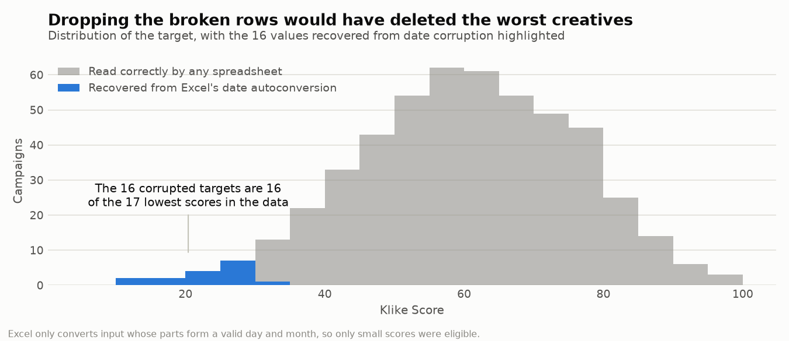
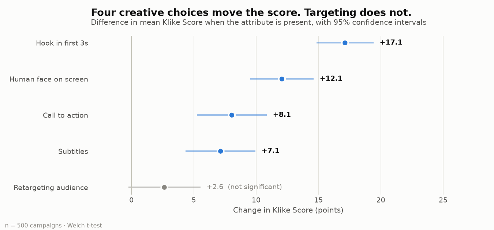
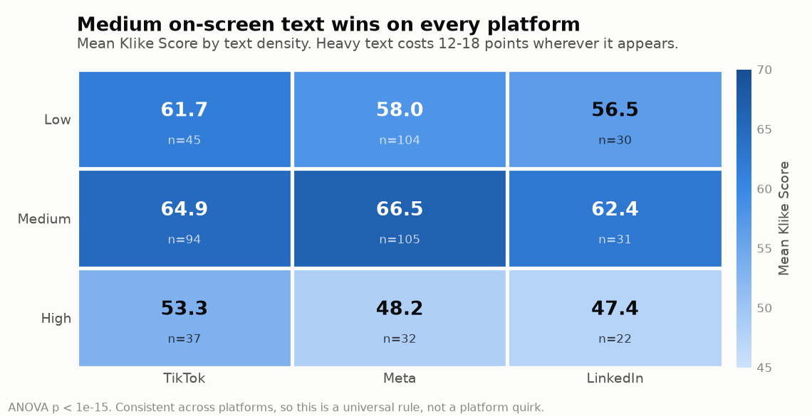
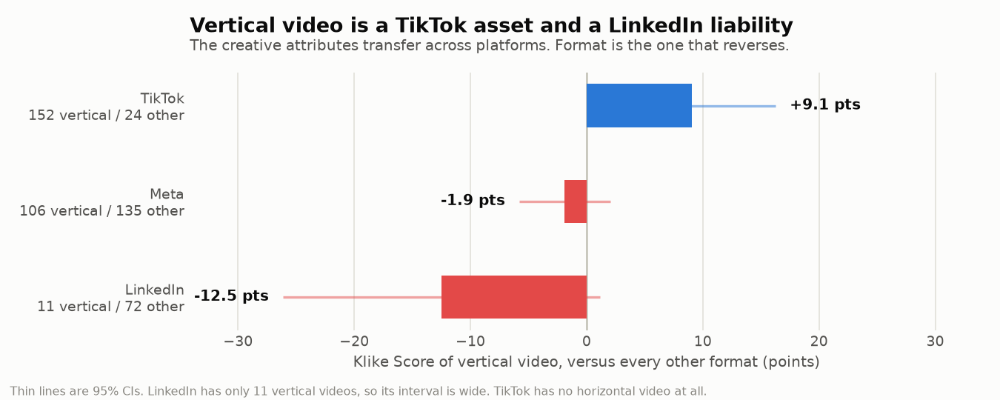
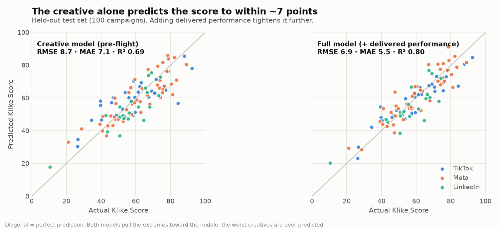
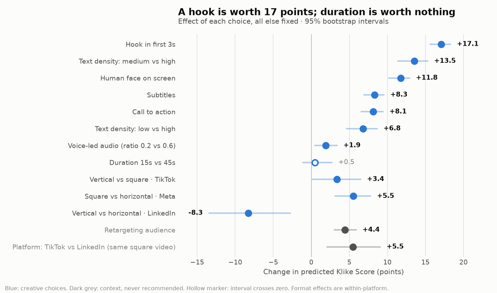
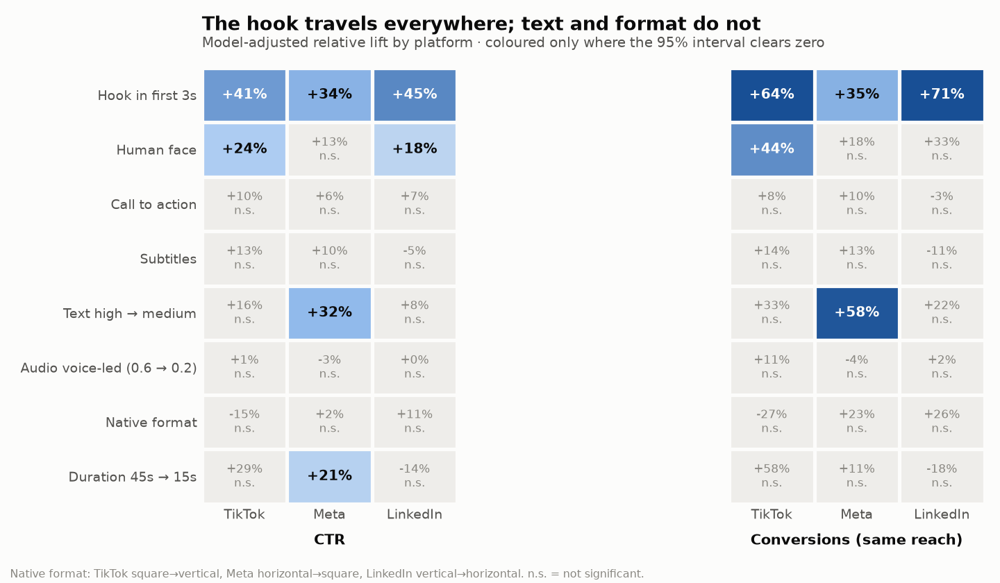
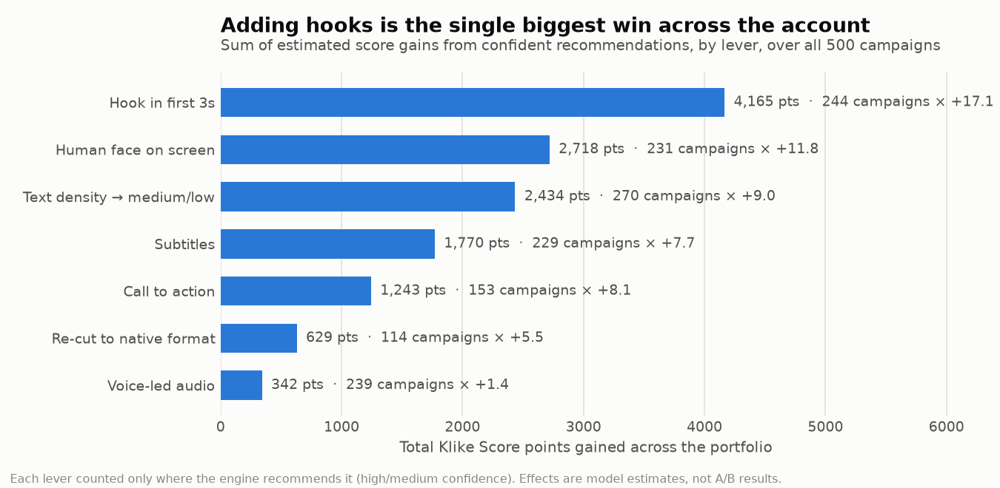

# Klike Data Science Challenge

This repo has my solution to the Klike challenge: an exploratory analysis of 500 video ad
campaigns, a model for the Klike Score and a simple recommendations engine that suggests changes
to a creative.

Main results:

- The spreadsheet had numbers that Excel converted into dates. I recovered them instead of
  dropping the rows. 16 of those were Klike Scores, and they turned out to be almost all of the
  lowest scores in the dataset.
- The score depends mostly on a few creative choices. Having a hook in the first 3 seconds adds
  around 17 points, medium text instead of heavy text around 13, a face around 12, and subtitles
  and a CTA around 8 each. Duration has no effect. Format depends on the platform (vertical is
  good on TikTok and bad on LinkedIn).
- A ridge regression using only pre-launch information predicts the score with an average error of
  about 7 points (R² 0.71). Adding post-launch metrics like CTR brings it to 0.84.
- The engine ranks possible changes by their estimated effect on the score and shows the effect on
  CTR, engagement and conversions for the campaign's platform.

## Running the project

```bash
python -m venv .venv
.venv\Scripts\activate             # macOS/Linux: source .venv/bin/activate
pip install -r requirements.txt

python recommend.py KLK-0116       # recommendations for one campaign
python recommend.py --random 3     # 3 random campaigns
python recommend.py --file new_campaign.json   # a campaign that is not in the dataset
python recommend.py --portfolio    # summary for all campaigns (takes ~1.5 min)

python -m pytest                   # tests
jupyter lab                        # notebooks (run in order: 01, 02, 03)
```

For a new campaign, the JSON needs the same columns as the dataset, for example:

```json
{"platform": "TikTok", "category": "E-commerce", "objective": "conversions", "target_audience_age": "18-24",
 "is_retargeting": false, "video_duration_s": 45, "format": "horizontal", "has_subtitle": false,
 "has_cta": true, "has_hook": false, "has_face": false, "text_density": "high", "music_voice_ratio": 0.8}
```

## Structure

```
01_eda.ipynb              Part 1, data cleaning and EDA
02_modeling.ipynb         Part 2, modeling
03_recommendations.ipynb  Part 3, recommendations engine
recommend.py              command line for the engine
klike/
  data.py                 reads and cleans the Excel file
  model.py                features and score model
  recommender.py          recommendations engine
tests/                    tests for cleaning, model and engine
data/klike_clean.csv      cleaned dataset
figures/                  charts used in this README
```

The notebooks have the full reasoning. The code in `klike/` does the same thing as the notebooks,
so the command line works without running them first.

---

## Part 1 - EDA

Notebook: [01_eda.ipynb](01_eda.ipynb)

### Data quality

I had to fix the data before analyzing it.

1. Some numbers were stored as dates. When you type something like `3.9` in Excel, it can be saved
   as September 3rd. This affected 558 cells, including 16 values of `klike_score`. Excel kept the
   display format of each cell, so I used it to get the original numbers back.
2. The `ctr` column mixed different units (fraction, per mille and basis points). I recalculated
   CTR, CPC and ROAS from clicks, impressions, spend and revenue.
3. Since CTR, CPC and ROAS are calculated from the same columns, I could check which values didn't
   add up and find the wrong cell. I rebuilt 4 impression values and 2 spend values. For the spend
   ones, the ROAS recalculated with the fixed spend matches the ROAS that came in the file.
4. Missing values are between 5% and 9% in 7 columns, and the score is the same whether they are
   missing or not. I didn't fill them in the clean data. The model pipeline does it during training.
5. Spend, revenue, impressions and clicks are very skewed. I looked for outliers on a log scale,
   where only a few values stand out. I flagged them but kept them in the data.
6. 72 campaigns have revenue equal to zero, mostly awareness and engagement campaigns. I treated
   these as revenue not tracked and left them out of the ROAS analysis.

I didn't drop any rows. Excel only converts numbers that look like a valid day and month, so the
damaged scores were the small ones. If I had dropped the rows that didn't parse, I would have lost
16 of the 17 worst creatives.



### Attributes vs. performance

Difference in the median when the attribute is present:

| Attribute | Klike Score | CTR | Conversions | Engagement |
|---|---|---|---|---|
| Hook in first 3s | +17 pts | +68% | +33% | +42% |
| Human face | +12 pts | +37% | +45% | +38% |
| Call to action | +8 pts | +14% | +28% | +10% |
| Subtitles | +7 pts | +15% | +9% | +12% |
| Retargeting | +3 (not significant) | +71% | +237% | +19% |

The hook is the attribute with the biggest effect overall. For text density, medium has the best
average score (65), then low (59) and high (50). Retargeting increases CTR and conversions a lot but
doesn't change the score much. That's expected, since it's about the audience and not about the
video. ROAS doesn't respond to any of the creative attributes, probably because it depends on price
and offer, which aren't in the dataset.




### Differences between platforms

Hook, face, CTA and subtitles have similar effects on TikTok, Meta and LinkedIn. Format is
different. Vertical video scores 9 points higher on TikTok and 12 points lower on LinkedIn (with
only 11 vertical videos on LinkedIn, so this one is less certain). ROAS is also much lower on
LinkedIn, with a median of 0.6 against 3.0 on TikTok.



---

## Part 2 - Modeling

Notebook: [02_modeling.ipynb](02_modeling.ipynb)

### Two models

I trained two versions:

- Creative model: uses only information available before the ad runs (video attributes, platform,
  category, objective and audience). This is the one used by the recommendations engine.
- Full model: also uses CTR, completion rate and conversion rate, which only exist after launch.

I kept them separate because the engine needs to evaluate a creative before it runs. The full model
is useful to see how much of the score is explained by performance.

### Feature engineering

I tested each new feature by checking if it improved the cross-validation score.

- Kept: platform × format, because vertical has opposite effects on TikTok and LinkedIn. For the
  full model, CTR in log scale worked much better than raw CTR (+0.11 vs +0.07 in R²).
- Tested and removed: hook × face, duration squared, month, platform × text density. None of them
  improved the model.
- Not used: spend, impressions and revenue, because they reflect budget size and not creative
  quality. I also didn't use average watch time, since it depends on video length. Completion rate
  is used instead.

### Model comparison

5-fold cross-validation, repeated 5 times:

| Model | MAE | R² |
|---|---|---|
| Baseline (mean) | 12.6 | 0.00 |
| Ridge, creative | 6.6 | 0.71 |
| Gradient boosting, creative | 6.9 | 0.68 |
| Random forest, creative | 7.7 | 0.62 |
| Ridge, full | 4.9 | 0.84 |

I chose ridge regression. It had the best results, and the tree models didn't find anything extra,
so the relationship seems to be mostly additive. A linear model also makes the engine easier to
explain, because each coefficient is directly the number of points a change is worth.

### Evaluation

On a test set of 100 campaigns, the creative model has an MAE of 7.1 points and R² of 0.69. The full
model has an MAE of 5.5. An error of 7 points is enough to separate weak and strong creatives, but
not to predict an exact score. The model also overestimates the worst creatives by around 10 points
and underestimates the best ones, so some of what makes a video very good or very bad isn't
captured by these columns.



### Feature importance



These results agree with common creative practice. The first seconds decide if people keep
watching, some text helps when the video is muted, and faces, subtitles and a CTA all help. Context
variables like category and audience age have small effects compared to the creative attributes.

Something I noticed and would mention to the Klike team: with the creative fixed, retargeting adds
about 4 points to the score, and this disappears when CTR is added to the model. It looks like the
score is picking up part of the audience effect through CTR.

---

## Part 3 - Recommendations engine

Notebook: [03_recommendations.ipynb](03_recommendations.ipynb)

### How it works

1. It lists the changes that are possible for the campaign: adding a hook, face, CTA or subtitles,
   changing text density, changing to a format that is common on the platform, using more voice in
   the audio, or changing the duration.
2. For each change, it estimates the effect on the Klike Score with the creative model, and the
   effect on CTR, engagement and conversions with separate models that consider the platform. The
   95% intervals come from bootstrap.
3. It removes changes that are not likely to help, and changes that would reduce the metric related
   to the campaign objective (for example, conversions in a conversion campaign).
4. It sorts the remaining changes by score gain.
5. It adds a comparison with similar campaigns to each recommendation.

Retargeting is never recommended, since it's a targeting decision and not part of the creative.

### Example

```
$ python recommend.py KLK-0116

Campaign KLK-0116 · LinkedIn · Lead Gen · engagement · age 35-44
Klike Score 10.4  (creative model expects 15.6; potential with the changes below ≈ 77.5)

1. Add a hook in the first 3 seconds: Klike Score +17.1 pts (95% CI +15.7 to +18.4). On this platform
   it is associated with +45% CTR, +7% engagement rate, +71% conversions at the same reach
   (model-adjusted). 86% of top-quartile LinkedIn creatives open with a hook, vs 19% of the bottom
   quartile (n=83).
2. Change on-screen text from high to medium: Klike Score +13.5 pts (95% CI +11.4 to +15.4). ...
3. Show a human face on screen: Klike Score +11.8 pts (95% CI +10.6 to +13.1). ...
4. Add subtitles: Klike Score +8.3 pts ...
5. Re-cut the video from vertical (9:16) to horizontal (16:9): Klike Score +8.3 pts ...
6. Add an explicit call to action: Klike Score +8.1 pts ...
```

KLK-0116 has the lowest score in the dataset. For a TikTok campaign with the same attributes, the
format recommendation would be vertical instead of horizontal.

### Platform and objective



The hook improves CTR and conversions on all platforms. The effect of a face is strongest on
TikTok. Reducing heavy text only has a clear effect on CTR on Meta, and shorter videos also only
help CTR on Meta.

The objective also changes the result. On TikTok, going from square to vertical increases the score
and engagement, but the estimated effect on conversions is -27%. The engine recommends this change
for engagement campaigns and not for conversion campaigns.

### Campaigns that are already good

The challenge asks for at least 3 recommendations, but some creatives don't have 3 useful changes
left (the best one has a score of 99.1). In these cases, the engine completes the list with
suggestions to test in an A/B test, or with things the creative should keep, like "keep the hook,
removing it would cost about 17 points". 64% of the campaigns get at least 3 recommendations with
good evidence.

### All campaigns



The biggest opportunity in the dataset is adding a hook to the 244 campaigns that don't have one.

---

## Part 4 - Product questions

### 1. Features from the original video

The dataset only says if a video has a hook, a face or text. With the video file, I would try to
measure these things in more detail:

- First 3 seconds: number of cuts, amount of movement, time until the first face, product or spoken
  word.
- Pacing: number of shots and average shot length. My guess is that this matters more than total
  duration.
- Faces: time on screen, if the person looks at the camera, studio vs. UGC style.
- Text, using OCR: how much of the screen it covers and if there is enough time to read it.
- Audio, using speech-to-text: words per minute, when the brand is mentioned, how the CTA is said,
  music tempo and trending sounds on TikTok.
- Branding: when the logo appears and how long the product is shown.
- Video embeddings, to find similar creatives with high scores and show them as examples.

If retention per second is available, it would also be possible to point to the moment where
viewers leave the video.

### 2. Production

I would split it into two flows. Before launch, the user uploads the video and gets the score and
recommendations. After launch, a daily job updates the scores with the real metrics and sends a
summary of the main opportunities.

For the architecture, videos would be saved in storage and processed by workers from a queue to
extract features. This is the heaviest part, so these workers would need GPUs and autoscaling, and
results would be cached per video. The features would go to a feature store, and an API would
return the recommendations to the Klike app. The models themselves are linear, so inference is
fast, and the bootstrap coefficients can be computed in advance.

The models would be retrained periodically, and a new version would only replace the old one if it
is at least as accurate and its effects are stable. Comparisons with similar campaigns would only
use groups with a minimum number of campaigns, so that one client's data isn't exposed to another.

I think the most important part is testing the recommendations. The current numbers are
correlations from historical data. When a client applies a recommendation, it could run as an A/B
test (Meta and TikTok support this), and the results would be used to correct the estimates.

### 3. With more time

- Use causal methods, like matching or double machine learning, to estimate the effects.
- Try a hierarchical model by platform and category, which would deal better with small groups like
  LinkedIn.
- Consider the effort of each change in the ranking (adding subtitles is much easier than recording
  a new video) and convert CTR gains into expected revenue.
- Model what happens when several changes are made at the same time.
- Investigate the retargeting effect on the score and confirm with the Klike team the unit of
  `engagement_rate`.
- Build a simple interface for the engine.

---

## Assumptions and limitations

- The effects come from historical data, not from experiments. The models control for platform,
  category, objective, audience and retargeting, but other factors could be involved.
- I assumed `engagement_rate` is in basis points. 13 values below 1 looked like placeholders and
  were not used in the engagement model.
- LinkedIn has only 83 campaigns, 11 of them vertical, so the LinkedIn estimates are less precise.
- The potential score assumes the effects of the recommended changes add up, so it should be seen
  as an upper estimate.
